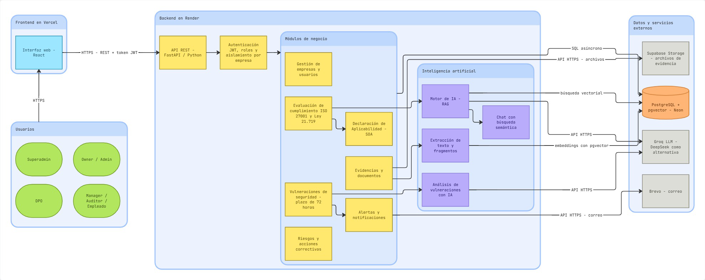
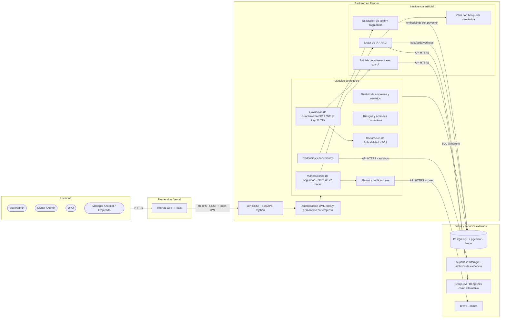
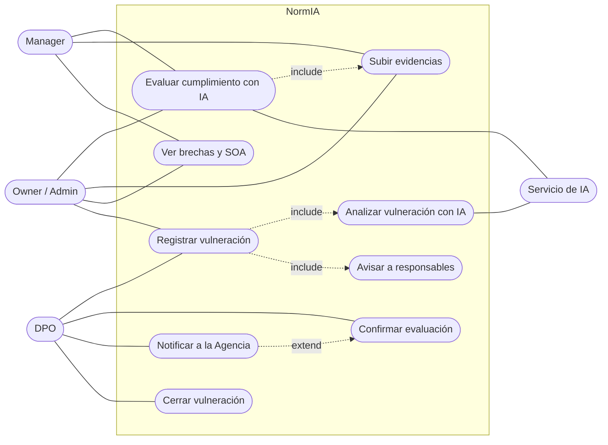
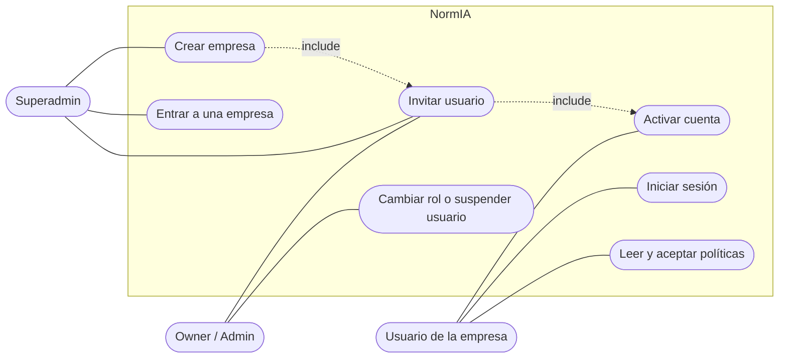
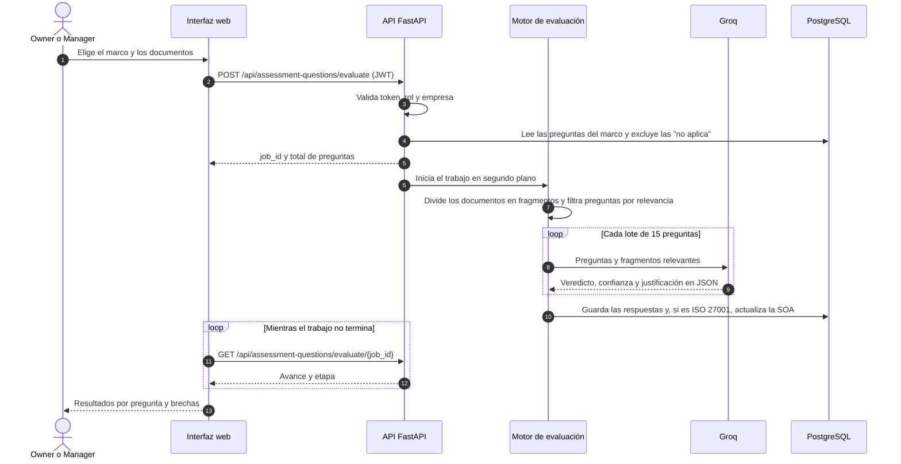
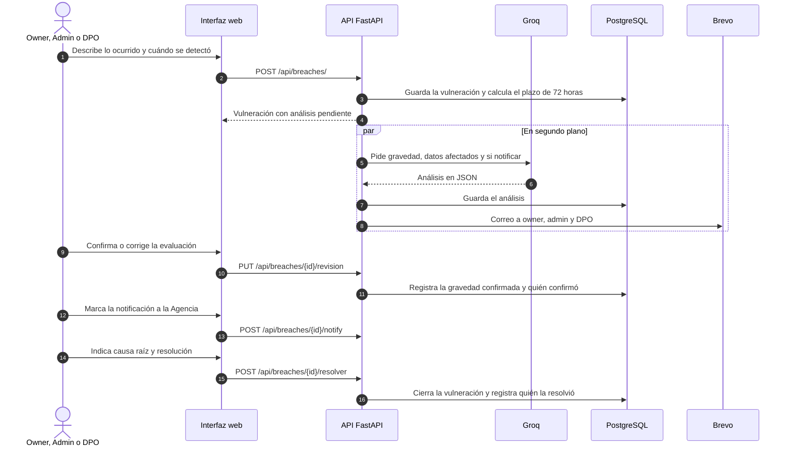
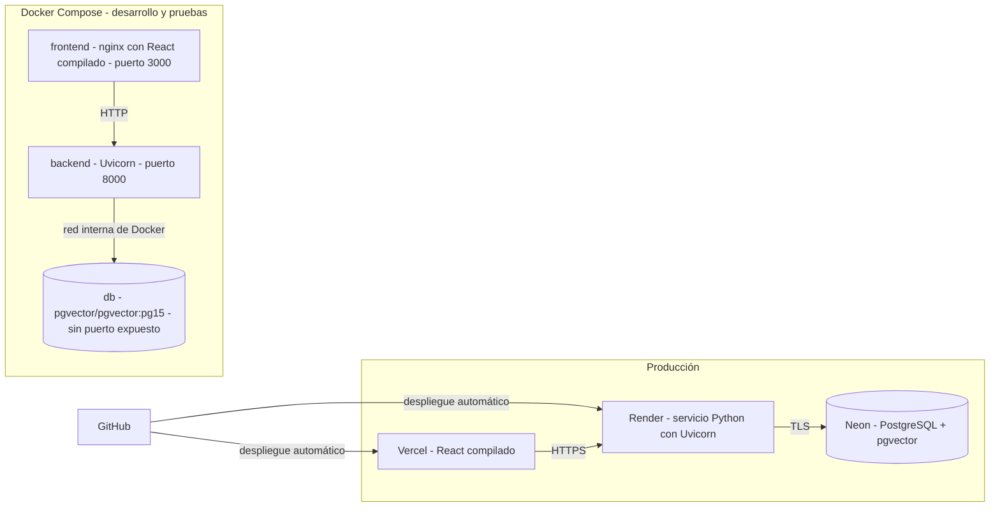

# Documento de diseño de NormIA

Este documento describe cómo está construida NormIA y por qué: la arquitectura, los componentes y su comunicación, las decisiones técnicas con sus alternativas, los diagramas UML de la funcionalidad principal y el diseño de seguridad, de inteligencia artificial y de despliegue.

Documentos relacionados:

- [Modelo de datos](Modelo_de_Datos.md): diagrama entidad-relación completo.
- [Diagrama de clases UML](UML_Clases.md) y [diagrama de componentes UML](UML_Componentes.md).
- [Requisitos no funcionales](Requisitos_No_Funcionales.md).
- [Manual técnico](Manual_Tecnico.md): instalación, variables de entorno y Docker Compose.
- [Plan de pruebas](Plan_de_Pruebas.md) y [plan de pruebas por sprint](Plan_de_Pruebas_por_Sprint.md).
- [Casos de uso](../entrega%202/Casos_de_Uso_GRC.docx): catálogo completo con actor y estado.

## 1. Alcance

NormIA es una plataforma web de gobierno, riesgo y cumplimiento (GRC) que ayuda a las organizaciones a cumplir ISO/IEC 27001:2022 y la Ley N.º 21.719 de protección de datos personales. El diseño cubre:

- La evaluación del cumplimiento con IA a partir de los documentos de cada empresa.
- La gestión de vulneraciones de seguridad con el plazo legal de 72 horas.
- La gestión de riesgos, la Declaración de Aplicabilidad (SOA), las evidencias y los documentos.
- La administración de varias empresas en una sola instalación, con datos separados.

## 2. Arquitectura

### 2.1 Diagrama de arquitectura

Figura 1. Diagrama de arquitectura de NormIA: componentes y comunicación. Elaborado en Miro; también disponible en [PDF](diagramas/arquitectura.pdf).

| Color | Significado |
|---|---|
| Verde | Usuarios (actores) |
| Celeste | Interfaz web |
| Amarillo | Lógica de negocio del backend |
| Morado | Componentes de inteligencia artificial |
| Naranja | Base de datos |
| Gris | Servicios externos |

La misma arquitectura, en una versión que GitHub dibuja directamente y que se actualiza junto con el código:

### 2.2 Componentes

| Componente | Tecnología | Responsabilidad | Ubicación en el código |
|---|---|---|---|
| Interfaz web | React 19 (Create React App), servida por Vercel o por nginx en Docker | Pantallas, navegación por empresa (`/:orgSlug/...`), manejo de sesión y reintentos cuando el backend despierta | `Producto/dani-project-front/src` |
| API REST | FastAPI y Uvicorn sobre Python 3.11 | Recibe las solicitudes, valida datos con Pydantic y ejecuta la lógica de negocio | `app/main.py`, `app/routes` |
| Autenticación y autorización | JWT (python-jose) y bcrypt (passlib) | Valida el token, comprueba que el usuario siga activo, aplica roles y fija la empresa de cada solicitud | `app/dependencies/auth.py`, `app/dependencies/tenant.py` |
| Módulos de negocio | FastAPI y SQLAlchemy asíncrono | Empresas y usuarios, riesgos, SOA, evaluación, vulneraciones, evidencias, documentos y notificaciones | `app/routes/*.py` |
| Motor de evaluación con IA | Servicio propio sobre el SDK de OpenAI | Filtra las preguntas relevantes, arma lotes con fragmentos del documento y obtiene el veredicto de la IA | `app/services/question_evaluator.py`, `app/services/ai_service.py` |
| Embeddings | FastEmbed (modelo multilingüe MiniLM; si no está disponible, `BAAI/bge-small-en-v1.5`) | Convierte los fragmentos de evidencias en vectores para la búsqueda semántica del chat | `app/services/embedding_service.py` |
| Base de datos | PostgreSQL con la extensión pgvector, en Neon | Datos de todas las empresas, separados por `organization_id`, y vectores de los fragmentos | `app/models`, `app/dependencies/database.py` |
| Almacenamiento de archivos | Supabase Storage | Archivos originales de las evidencias | `app/services/storage_service.py` |
| Correo | Brevo (API HTTPS), con SMTP como respaldo | Invitaciones, activación de cuentas y avisos de vulneraciones | `app/services/email_service.py` |

### 2.3 Comunicación entre servicios

| Origen | Destino | Protocolo | Autenticación | Qué se transmite |
|---|---|---|---|---|
| Navegador | Interfaz web (Vercel) | HTTPS | Ninguna | Archivos estáticos de React |
| Interfaz web | API REST (Render) | HTTPS, REST con JSON; `multipart/form-data` para subir archivos | Token JWT en `Authorization: Bearer`; el superadmin agrega `X-Org-Id` con la empresa elegida | Datos de cada módulo |
| API REST | PostgreSQL (Neon) | Protocolo de PostgreSQL con TLS, mediante SQLAlchemy asíncrono y asyncpg | Usuario y contraseña en `DATABASE_URL` | Consultas y transacciones; búsqueda por similitud con pgvector |
| API REST | Groq o DeepSeek | HTTPS, API compatible con OpenAI | Clave de API (`GROQ_API_KEY` o `DEEPSEEK_API_KEY`) | Instrucciones y fragmentos de documentos; respuestas en JSON |
| API REST | Supabase Storage | HTTPS, API REST | Clave de servicio (`SUPABASE_SERVICE_KEY`) | Subida, descarga y borrado de archivos |
| API REST | Brevo | HTTPS, API REST | Clave de API (`BREVO_API_KEY`) | Correos en HTML |

El navegador nunca habla directamente con la base de datos ni con los servicios externos: todo pasa por la API, que guarda las claves.

## 3. Decisiones técnicas

| # | Decisión | Alternativas consideradas | Motivo | Consecuencia |
|---|---|---|---|---|
| D1 | Mantener React, FastAPI y PostgreSQL de la plataforma existente | Reescribir con otra tecnología | El proyecto consistía en integrar la Ley 21.719 en una plataforma que ya funcionaba; reescribirla no aportaba al objetivo | El equipo tuvo que comprender un código que no escribió antes de modificarlo |
| D2 | PostgreSQL en Neon con la extensión pgvector | Base vectorial separada (Pinecone), Supabase como base de datos | Neon lo configuró el equipo anterior (commit `85e3332`). Se mantuvo porque ofrece PostgreSQL gestionado con plan gratuito y pgvector, de modo que los datos y los vectores viven en una sola base | Una sola conexión y una sola copia de seguridad; las búsquedas vectoriales usan SQL |
| D3 | Groq como proveedor principal de IA y DeepSeek como alternativa, mediante el SDK de OpenAI | Un solo proveedor, OpenAI | La migración a Groq la hizo el equipo anterior (commit `77108ca`). Se mantiene porque tiene plan gratuito y una API compatible con OpenAI: cambiar de proveedor solo requiere cambiar la clave | Hay que respetar el límite de llamadas por minuto del plan gratuito (ver D6). Cuando Groq retiró el modelo usado, bastó cambiar su nombre (commit `5388da7`) |
| D4 | Embeddings locales con FastEmbed | API de embeddings de un proveedor externo | No tiene costo por uso y no envía los documentos a un tercero para vectorizarlos | Consume CPU y memoria del servidor; se limitó a un hilo y lotes pequeños para no superar los 512 MB del plan gratuito de Render |
| D5 | Evaluación con IA a partir de los documentos de la empresa | Cuestionario respondido manualmente | El diagnóstico queda respaldado por evidencia verificable, que es lo que pide un auditor | Requiere extraer texto de PDF, Word y Excel; los PDF escaneados sin texto no se pueden evaluar |
| D6 | Filtro de relevancia por palabras clave, lotes de 15 preguntas y trabajo en segundo plano | Enviar todo el documento con cada pregunta | Con cientos de preguntas se superaba el límite de Groq y el tiempo de espera del navegador | Las preguntas sin relación con el documento quedan como "sin evidencia" sin gastar llamadas; el avance se consulta con `GET /evaluate/{job_id}` |
| D7 | La IA propone y una persona confirma (vulneraciones) | Que la IA decida sola la gravedad y la notificación | La ley exige responsabilidad del responsable del tratamiento; la IA puede equivocarse | La gravedad queda marcada como confirmada o no, y se registra quién la confirmó |
| D8 | Varias empresas en una sola base, separadas por `organization_id` | Una base de datos o un esquema por empresa | Es más simple de operar con un plan gratuito y permite que una consultora atienda a varios clientes | Cada consulta debe filtrar por empresa; se centralizó en `get_current_org`, `scope_to_org` y `get_scoped_or_404`, y se probó con dos empresas reales |
| D9 | Sesión con JWT y verificación de usuario activo en cada solicitud | Sesiones guardadas en el servidor | El JWT no necesita almacenar sesiones; la consulta extra permite que una suspensión tenga efecto inmediato | Una consulta adicional por solicitud, sin impacto medible en las pruebas de rendimiento |
| D10 | Correo por la API HTTPS de Brevo, con SMTP como respaldo | Solo SMTP | Render bloquea el envío SMTP saliente en su plan gratuito (commit `0b13f6a`) | Si el correo falla, la operación principal igual se guarda |
| D11 | Archivos de evidencia en Supabase Storage | Guardarlos en la base de datos o en el disco del servidor | El disco de Render se borra en cada despliegue y guardar archivos en la base la haría crecer rápido | La base solo guarda los metadatos y el texto extraído |
| D12 | Frontend en Vercel y backend en Render | Un servidor propio | Ambos tienen plan gratuito y despliegan solos desde GitHub | El backend gratuito se suspende sin uso y tarda cerca de un minuto en reactivarse; el frontend reintenta automáticamente |
| D13 | Migraciones controladas al iniciar la aplicación (`ALTER TABLE ... IF NOT EXISTS`) | Alembic | El proyecto heredado no tenía migraciones y `create_all` no modifica tablas existentes | Cada cambio de esquema se agrega en `app/main.py` y es seguro de repetir |
| D14 | Docker Compose para levantar el sistema completo | Instalar Python, Node.js y PostgreSQL a mano | Cualquier persona lo levanta con un comando, igual en todos los equipos | La producción no usa contenedores; Compose es para desarrollo, pruebas y revisión |
| D15 | Retirar los módulos de tratamientos, consentimientos, solicitudes de titulares, proveedores y evaluación de impacto | Mantenerlos | Indicación del docente: evaluar la Ley 21.719 con preguntas, igual que ISO 27001 (commit `390b324`) | Las tablas se conservaron para no perder datos; la ley se cubre con 24 preguntas y el módulo de vulneraciones |

## 4. Diseño de los módulos

| Módulo | Rutas de la API | Pantalla | Tablas principales | Roles |
|---|---|---|---|---|
| Autenticación | `/api/auth` | `Login.jsx`, `ActivateScreen.jsx` | `users` | Todos |
| Empresas | `/api/organizations` | `OrganizationsScreen.jsx` | `organizations` | Superadmin |
| Usuarios | `/api/users` | `UserManagementScreen.jsx` | `users` | Superadmin, owner, admin |
| Evaluación de cumplimiento | `/api/assessment-questions`, `/api/gap-analysis` | `GapAnalysisScreen.jsx`, `QuestionsScreen.jsx` | `assessment_questions`, `assessment_answers`, `control_status` | Owner, admin, manager; auditor y DPO en lectura según la matriz |
| SOA | `/api/compliance` | `GapAnalysisScreen.jsx` | `iso_controls`, `control_status` | Owner, admin, manager, auditor, DPO |
| Riesgos y acciones correctivas | `/api/risks`, `/api/capas` | `RiskMapScreen.jsx` | `risks`, `capas` | Owner, admin, manager |
| Vulneraciones de seguridad | `/api/breaches` | `BreachesScreen.jsx` | `data_breaches` | Owner, admin, DPO |
| Evidencias | `/api/evidence` | `EvidenceCenterScreen.jsx` | `evidences`, `evidence_chunks` | Owner, admin, manager, auditor |
| Documentos | `/api/documents` | `DocGeneratorScreen.jsx`, `DocumentsScreen.jsx`, `EmployeePortal.jsx` | `documents`, `document_acknowledgements` | Equipo; los empleados leen y confirman |
| Asistente | `/api/chat` | `ChatDANI.jsx` | `evidence_chunks`, `normative_chunks` | Usuarios con sesión |
| Notificaciones | `/api/notifications` | Campana del encabezado | Se calculan a partir de los demás módulos | Usuarios con sesión |

## 5. Modelo de datos

El diagrama entidad-relación completo está en [Modelo_de_Datos.md](Modelo_de_Datos.md). Las reglas de diseño son:

- Toda tabla con datos de una empresa tiene `organization_id`. Los catálogos globales (controles ISO, preguntas, normativa y prompts) no lo tienen porque son iguales para todas.
- Los identificadores son UUID en texto, generados por la aplicación.
- Las tablas guardan `created_at` y `updated_at`; las vulneraciones además guardan quién reportó, confirmó y resolvió.
- `evidence_chunks.embedding` es una columna `vector` de pgvector con los fragmentos de cada evidencia.

## 6. Diagramas UML

### 6.1 Casos de uso

Mermaid no tiene un tipo de diagrama de casos de uso, por lo que se representan con su notación habitual: actores fuera del sistema, casos dentro del límite del sistema y las relaciones `include` y `extend` como flechas punteadas.

Casos de uso de la Ley 21.719 y la evaluación de cumplimiento:

Casos de uso de la plataforma y la gestión de usuarios:

El catálogo completo, con unos 70 casos y su estado, está en [Casos_de_Uso_GRC.docx](../entrega%202/Casos_de_Uso_GRC.docx).

### 6.2 Clases

El diagrama de clases de los modelos está en [UML_Clases.md](UML_Clases.md).

### 6.3 Secuencia de la funcionalidad principal

Evaluación de cumplimiento con IA, la función central de la plataforma:

Gestión de una vulneración de seguridad, la función principal de la Ley 21.719:

### 6.4 Componentes

El diagrama de componentes está en [UML_Componentes.md](UML_Componentes.md). La sección 2.2 de este documento resume la responsabilidad de cada uno.

## 7. Diseño de seguridad

| Aspecto | Diseño | Dónde se prueba |
|---|---|---|
| Contraseñas | Se guardan solo como hash bcrypt; ninguna respuesta las incluye | `test_seguridad.py`, `security/prueba_seguridad.py` |
| Sesión | JWT firmado con HS256 y `SECRET_KEY`; dura 240 minutos por defecto | `test_seguridad.py` |
| Tokens especiales | El enlace de activación lleva `purpose` y no sirve como sesión | `test_seguridad.py` |
| Usuario suspendido | Cada solicitud comprueba que el usuario exista y esté activo | `test_seguridad.py`, `security/prueba_seguridad.py` |
| Fuerza bruta | 5 intentos fallidos por correo e IP bloquean el inicio de sesión 15 minutos (respuesta 429) | `test_seguridad.py`, `security/prueba_seguridad.py` |
| Roles | `RequireRole` aplica la matriz de permisos; owner y superadmin pasan por jerarquía; nadie asigna un rol superior al propio | `test_seguridad.py`, `test_breaches_permisos.py` |
| Separación entre empresas | La empresa sale del token; `X-Org-Id` solo lo acepta para el superadmin | `test_seguridad.py`, `security/prueba_seguridad.py` |
| CORS | Solo orígenes locales y dominios de Vercel; cabeceras permitidas `Authorization`, `Content-Type` y `X-Org-Id` | `test_general.py` |
| Secretos | Solo en variables de entorno; `.env.example` sin valores reales; el log no muestra la contraseña de la base de datos | Revisión del repositorio |

## 8. Diseño de la inteligencia artificial

- El cliente de IA (`ai_service.py`) usa Groq si existe `GROQ_API_KEY` y, si no, DeepSeek. Ambos se llaman con el SDK de OpenAI.
- Las instrucciones piden la respuesta en JSON con un formato fijo, y el backend lo interpreta de forma tolerante: acepta el JSON dentro de bloques de código y normaliza valores inválidos.
- La evaluación de cumplimiento usa instrucciones de auditor distintas para ISO 27001 y para la Ley 21.719, y nunca mezcla los marcos.
- Los veredictos posibles son `cumple`, `parcial`, `no_cumple` y `sin_evidencia`; la empresa puede marcar una pregunta como `no_aplica`.
- El chat busca los fragmentos más parecidos a la pregunta del usuario con la distancia coseno de pgvector, tanto en las evidencias de la empresa como en la normativa.
- En vulneraciones, la IA solo propone. La gravedad queda como no confirmada hasta que una persona la revisa.
- Si la IA no responde, la evaluación marca el error y se puede reintentar; el análisis de una vulneración tiene un botón para volver a pedirlo.

## 9. Despliegue y Docker

- `Producto/dani-project-back/Dockerfile`: imagen `python:3.11-slim` que instala `requirements.txt` y arranca Uvicorn en el puerto 8000.
- `Producto/dani-project-front/Dockerfile`: construcción en dos etapas. `node:20-alpine` compila React con `REACT_APP_API_URL`, y `nginx:1.27-alpine` sirve el resultado con redirección de rutas a `index.html`.
- `Producto/docker-compose.yml`: levanta la base de datos, el backend y el frontend. El backend espera a que la base de datos esté sana.
- Los `.dockerignore` excluyen `node_modules`, entornos virtuales y archivos `.env`.

El detalle de comandos y variables está en el [manual técnico](Manual_Tecnico.md).

## 10. Relación con los requisitos no funcionales

| Requisito | Decisiones que lo cubren |
|---|---|
| Seguridad (RNF-05 a RNF-12) | D8, D9 y sección 7 |
| Rendimiento (RNF-01, RNF-02, RNF-17) | D4, D6; resultados en el plan de pruebas, sección 5.1 |
| Disponibilidad (RNF-13 a RNF-16) | D10, D12; reintentos del frontend y `/health` |
| Escalabilidad (RNF-17 a RNF-20) | D2, D8 |
| Portabilidad | D14 |
| Mantenibilidad (RNF-25 a RNF-29) | D1, D13; separación en `routes`, `services`, `models` y `dependencies` |
| Cumplimiento legal (RNF-30 a RNF-33) | D7, D15 |

## 11. Limitaciones conocidas

- Los trabajos de evaluación y el contador de intentos de inicio de sesión se guardan en memoria. Funcionan con el despliegue actual de un solo proceso, pero se pierden si el servidor se reinicia y no se comparten entre varios procesos.
- El plan gratuito de Render tiene 512 MB de memoria y se suspende sin uso; la primera solicitud después de la suspensión tarda cerca de un minuto.
- Los PDF escaneados, que son solo imagen, no se pueden evaluar porque no se extrae texto de ellos.
- No existe un límite de tamaño para las evidencias (RNF-03).
