# Modelo de Datos - NormIA

El modelo siguiente toma los nombres de tablas y relaciones explícitas de los modelos SQLAlchemy bajo `Producto/dani-project-back/app/models`. El campo de organización representa el aislamiento multiempresa cuando existe en el modelo.

```mermaid
erDiagram
    ORGANIZATIONS ||--o{ USERS : contiene
    ORGANIZATIONS ||--o{ RISKS : contiene
    ORGANIZATIONS ||--o{ EVIDENCES : contiene
    ORGANIZATIONS ||--o{ DOCUMENTS : contiene
    ORGANIZATIONS ||--o{ ASSESSMENT_ANSWERS : contiene
    ORGANIZATIONS ||--o{ CONTROL_STATUS : contiene
    ORGANIZATIONS ||--o{ DATA_TREATMENTS : contiene
    ORGANIZATIONS ||--o{ CONSENTS : contiene
    ORGANIZATIONS ||--o{ CONSENT_HISTORY : contiene
    ORGANIZATIONS ||--o{ DATA_SUBJECT_REQUESTS : contiene
    ORGANIZATIONS ||--o{ DATA_BREACHES : contiene
    ORGANIZATIONS ||--o{ VENDORS : contiene
    ORGANIZATIONS ||--o{ IMPACT_ASSESSMENTS : contiene
    ORGANIZATIONS ||--o{ CAPAS : contiene

    USERS ||--o{ RISKS : crea
    USERS ||--o{ EVIDENCES : carga
    USERS ||--o{ DOCUMENTS : solicita
    USERS ||--o{ DOCUMENT_ACKNOWLEDGEMENTS : reconoce
    USERS ||--o{ GAP_ANALYSIS : responsable

    RISKS ||--o{ EVIDENCES : soporta
    RISKS ||--o{ RISK_ASSESSMENTS : evalua
    EVIDENCES ||--o{ EVIDENCE_CHUNKS : fragmenta
    ASSESSMENT_QUESTIONS ||--o{ ASSESSMENT_ANSWERS : responde
    DOCUMENTS ||--o{ DOCUMENT_ACKNOWLEDGEMENTS : requiere
    GAP_ANALYSIS ||--o{ REMEDIATION_ACTIONS : genera

    DATA_TREATMENTS ||--o{ CONSENTS : base
    DATA_TREATMENTS ||--o{ VENDORS : utiliza
    DATA_TREATMENTS ||--o{ IMPACT_ASSESSMENTS : evalua
    CONSENTS ||--o{ CONSENT_HISTORY : registra

    ORGANIZATIONS {
        string id PK
        string nombre
        string slug
        string identificador
        boolean activo
        string plan
    }

    USERS {
        string id PK
        string organization_id FK
        string email
        string full_name
        string hashed_password
        string role
        boolean is_active
        json preferences
        string push_token
    }

    RISKS {
        string id PK
        string organization_id FK
        string created_by FK
        string title
        string category
        integer likelihood
        integer impact
        string risk_level
        string status
    }

    RISK_ASSESSMENTS {
        string id PK
        string risk_id FK
        text ai_analysis
        json recommendations
        float confidence_score
        integer version
    }

    EVIDENCES {
        string id PK
        string organization_id FK
        string risk_id FK
        string uploaded_by FK
        string title
        string evidence_type
        string file_url
        boolean is_verified
    }

    EVIDENCE_CHUNKS {
        string id PK
        string evidence_id FK
        string organization_id
        text content
        vector embedding
        integer chunk_index
    }

    DOCUMENTS {
        string id PK
        string organization_id
        string user_id FK
        string title
        text content
        string status
        boolean generated_by_ai
    }

    DOCUMENT_ACKNOWLEDGEMENTS {
        string id PK
        string document_id FK
        string user_id FK
        datetime acknowledged_at
    }

    ASSESSMENT_QUESTIONS {
        string id PK
        string marco
        string codigo
        string categoria
        string nombre
        text pregunta
        integer orden
    }

    ASSESSMENT_ANSWERS {
        string id PK
        string question_id FK
        string organization_id FK
        string veredicto
        float confianza
        text justificacion
    }

    ISO_CONTROLS {
        string id PK
        string control_id
        string domain
        string title
        text description
    }

    CONTROL_STATUS {
        string id PK
        string organization_id FK
        string control_id
        boolean applies
        string status
        integer score
        string document_id
    }

    CAPAS {
        string id PK
        string organization_id
        string nc_code
        string title
        string assignee
        string priority
        string status
        datetime due_date
    }

    GAP_ANALYSIS {
        string id PK
        string user_id FK
        string control_id
        string clause_id
        text requirement
        string status
        float score
    }

    REMEDIATION_ACTIONS {
        string id PK
        string gap_id FK
        string title
        string status
        integer estimated_hours
        json dependencies
    }

    CONTROL_IMPLEMENTATION {
        string id PK
        string control_id
        string title
        string implementation_status
        integer completion_percentage
    }

    KPI {
        string id PK
        string name
        string category
        float target_value
        float current_value
        string status
    }

    DATA_TREATMENTS {
        string id PK
        string organization_id FK
        string nombre
        text finalidad
        string base_licitud
        json categorias_datos
        string plazo_conservacion
        string responsable
    }

    CONSENTS {
        string id PK
        string organization_id FK
        string treatment_id FK
        string estado
        string titular
        string titular_email
        json finalidades_consentidas
        datetime fecha_otorgado
        datetime fecha_revocado
        string acceptance_token_hash
    }

    CONSENT_HISTORY {
        string id PK
        string consent_id FK
        string organization_id FK
        string action
        string actor_type
        string actor_identifier
        datetime created_at
    }

    DATA_SUBJECT_REQUESTS {
        string id PK
        string organization_id FK
        string tipo
        string estado
        string titular_nombre
        string titular_email
        text descripcion
    }

    DATA_BREACHES {
        string id PK
        string organization_id FK
        datetime fecha_deteccion
        text descripcion
        string reportado_por
        string gravedad
        json analisis_ia
        string analisis_estado
        boolean gravedad_confirmada
        boolean notificacion_requerida
        datetime fecha_limite_notificacion
        datetime fecha_notificacion
        string estado
        text causa_raiz
        text resolucion
        string resuelta_por
    }

    VENDORS {
        string id PK
        string organization_id
        string treatment_id FK
        string nombre
        string pais
        string contract_status
    }

    IMPACT_ASSESSMENTS {
        string id PK
        string organization_id
        string treatment_id FK
        string status
        string riesgo
        text medidas
    }

    AI_PROMPTS {
        string id PK
        string name
        string category
        text system_prompt
        text user_prompt_template
    }

    NORMATIVE_CHUNKS {
        string id PK
        string document_name
        string clause
        integer page_number
        text content
        vector embedding
    }

    LAW_OBLIGATIONS {
        string id PK
        string codigo
        string categoria
        string nombre
        string referencia_legal
        text descripcion
        string modulo
    }
```

## Descripción breve de tablas

| Tabla | Descripción |
|---|---|
| `organizations` | Empresa o inquilino multiempresa; contiene plan, estado e integraciones ERP. |
| `users` | Usuarios autenticados, rol jerárquico, preferencias y organización asociada. |
| `risks` | Riesgos empresariales con categoría, probabilidad, impacto y responsable. |
| `risk_assessments` | Evaluaciones o análisis realizados sobre un riesgo por IA o proceso interno. |
| `evidences` | Evidencias cargadas y verificadas; pueden relacionarse con riesgos. |
| `evidence_chunks` | Fragmentos de texto vectorizados asociados a una evidencia. |
| `documents` | Documentos del sistema y reconocimientos asociados. |
| `document_acknowledgements` | Confirmación de lectura o aceptación por un usuario. |
| `assessment_questions` | Catálogo global de preguntas ISO 27001 o Ley 21.719. |
| `assessment_answers` | Respuesta persistente por pregunta y organización. |
| `iso_controls` | Catálogo global de controles ISO 27001. |
| `control_status` | Estado, aplicabilidad y puntuación de controles por organización. |
| `capas` | Acciones correctivas y preventivas asociadas a auditorías, preauditorías u otros procesos. |
| `gap_analysis` | Brechas identificadas y análisis/score asociado. |
| `remediation_actions` | Planes concretos derivados de una brecha. |
| `control_implementation` | Estado de implementación y responsables de controles. |
| `kpi` | Indicadores estratégicos u operacionales y valores objetivo/actual. |
| `data_treatments` | Registro de tratamientos de datos personales Ley 21.719. |
| `consents` | Consentimientos vinculados a un tratamiento y titular. |
| `consent_history` | Historial de acciones sobre un consentimiento. |
| `data_subject_requests` | Solicitudes de titular como acceso, rectificación u eliminación. |
| `data_breaches` | Incidentes de seguridad o privacidad de datos personales. |
| `vendors` | Proveedores y estados contractuales asociados a tratamientos. |
| `impact_assessments` | Evaluaciones de impacto sobre tratamientos de datos. |
| `ai_prompts` | Plantillas de prompts y categorización para el servicio de IA. |
| `normative_chunks` | Fragmentos normativos con embeddings para recuperación semántica. |
| `law_obligations` | Catálogo de obligaciones legales de la Ley 21.719 almacenado por el modelo. |

## Nota de integridad

No se debe asumir que todas las tablas poseen clave externa a `organizations`: varias tablas globales (`iso_controls`, `assessment_questions`, `ai_prompts`, `normative_chunks`, `law_obligations`) son catálogos compartidos, según los comentarios y columnas presentes en sus modelos.
