# Diagrama de Clases UML - NormIA

El siguiente diagrama representa los modelos reales de SQLAlchemy ubicados en `Producto/dani-project-back/app/models`. Las asociaciones reflejan claves foráneas o relaciones declaradas en el código. No se incluyen asociaciones que no estén implementadas por el modelo.

```mermaid
classDiagram
    class Organization {
        +String id
        +String nombre
        +String slug
        +String identificador
        +Boolean activo
        +String plan
        +String erp_url
        +String erp_api_key
        +DateTime created_at
        +DateTime updated_at
    }

    class User {
        +String id
        +String email
        +String full_name
        +String hashed_password
        +UserRole role
        +Boolean is_active
        +JSON preferences
        +String push_token
        +String organization_id
        +DateTime created_at
        +DateTime last_login
    }

    class UserRole {
        <<enumeration>>
        superadmin
        owner
        admin
        employee
        manager
        auditor
        dpo
    }

    class Risk {
        +String id
        +String organization_id
        +String title
        +Text description
        +RiskCategory category
        +Integer likelihood
        +Integer impact
        +RiskLevel risk_level
        +RiskStatus status
        +JSON controls
        +String owner
        +String created_by
    }

    class RiskAssessment {
        +String id
        +String risk_id
        +Text ai_analysis
        +JSON recommendations
        +Float confidence_score
        +JSON controls_mapped
        +Integer version
    }

    class Evidence {
        +String id
        +String organization_id
        +String title
        +EvidenceType evidence_type
        +String file_url
        +String file_name
        +Integer file_size
        +Text extracted_text
        +Boolean is_verified
        +String risk_id
        +String uploaded_by
    }

    class EvidenceChunk {
        +String id
        +String organization_id
        +String evidence_id
        +Text content
        +SafeVector embedding
        +Integer chunk_index
    }

    class Document {
        +String id
        +String title
        +Text content
        +DocumentStatus status
        +String version
        +String user_id
        +String organization_id
        +Boolean generated_by_ai
    }

    class DocumentAcknowledgement {
        +String id
        +String user_id
        +String document_id
        +Boolean acknowledged
        +DateTime acknowledged_at
    }

    class AssessmentQuestion {
        +String id
        +String marco
        +String codigo
        +String categoria
        +String nombre
        +Text pregunta
        +Text evidencia_esperada
        +Integer orden
    }

    class AssessmentAnswer {
        +String id
        +String question_id
        +String organization_id
        +String veredicto
        +Float confianza
        +Text justificacion
        +DateTime created_at
        +DateTime updated_at
    }

    class ISOCControl {
        +String id
        +String control_id
        +String domain
        +String title
        +Text description
        +Text implementation_guidance
    }

    class ControlStatus {
        +String id
        +String control_id
        +String organization_id
        +Boolean applies
        +String status
        +Text justification
        +Integer score
        +String document_id
    }

    class CAPA {
        +String id
        +String nc_code
        +String title
        +Text root_cause
        +Text corrective_action
        +String assignee
        +String control
        +CAPAPriority priority
        +CAPAStatus status
        +CAPASource source
        +String organization_id
        +DateTime due_date
    }

    class GapAnalysis {
        +String id
        +String user_id
        +String control_id
        +String clause_id
        +String clause_name
        +Text requirement
        +String status
        +String priority
        +Float score
        +Text ai_response
    }

    class RemediationAction {
        +String id
        +String gap_id
        +String title
        +Text description
        +String status
        +Integer estimated_hours
        +JSON dependencies
        +String evidence_url
    }

    class ControlImplementation {
        +String id
        +String control_id
        +String title
        +String category
        +String implementation_status
        +Integer completion_percentage
        +String responsible
        +Float kpi_target
        +Float kpi_current
    }

    class KPI {
        +String id
        +String name
        +String category
        +String formula
        +Float target_value
        +Float current_value
        +String unit
        +String status
    }

    class DataTreatment {
        +String id
        +String organization_id
        +String nombre
        +Text finalidades
        +Text categorias_datos
        +Text titulares
        +Text destinatarios
        +Text transferencias_internacionales
        +String base_legal
        +String estado
    }

    class Consent {
        +String id
        +String organization_id
        +String treatment_id
        +ConsentState estado
        +String titular_nombre
        +String titular_email
        +DateTime fecha_otorgado
        +String acceptance_token_hash
    }

    class ConsentHistory {
        +String id
        +String consent_id
        +String organization_id
        +String accion
        +String realizado_por
        +Text detalle
        +DateTime created_at
    }

    class DataSubjectRequest {
        +String id
        +String organization_id
        +RequestType tipo
        +RequestState estado
        +String titular_nombre
        +String titular_email
        +Text descripcion
        +DateTime fecha_solicitud
    }

    class DataBreach {
        +String id
        +String organization_id
        +SeverityLevel gravedad
        +BreachState estado
        +String descripcion
        +String datos_afectados
        +Boolean gravedad_confirmada
        +DateTime fecha_ocurrencia
    }

    class Vendor {
        +String id
        +String organization_id
        +String nombre
        +String tratamiento
        +String pais
        +ContractStatus contract_status
        +String treatment_id
        +DateTime created_at
    }

    class ImpactAssessment {
        +String id
        +String organization_id
        +String treatment_id
        +ImpactStatus status
        +ImpactRiskLevel riesgo
        +Text necesidades
        +Text medidas
    }

    class AIPrompt {
        +String id
        +String name
        +String category
        +Text system_prompt
        +Text user_prompt_template
    }

    class NormativeChunk {
        +String id
        +String document_name
        +String clause
        +Integer page_number
        +Text content
        +SafeVector embedding
    }

    class LawObligation {
        +String id
        +String ley
        +String articulo
        +Text titulo
        +Text descripcion
    }

    Organization "1" --> "0..*" User : users
    Organization "1" --> "0..*" Risk
    Organization "1" --> "0..*" Evidence
    Organization "1" --> "0..*" AssessmentAnswer
    Organization "1" --> "0..*" ControlStatus
    Organization "1" --> "0..*" DataTreatment
    Organization "1" --> "0..*" Consent
    Organization "1" --> "0..*" ConsentHistory
    Organization "1" --> "0..*" DataSubjectRequest
    Organization "1" --> "0..*" DataBreach
    Organization "1" --> "0..*" Vendor
    Organization "1" --> "0..*" ImpactAssessment

    User --> UserRole
    User "1" --> "0..*" Risk : creator
    User "1" --> "0..*" Evidence : uploader
    User "1" --> "0..*" Document : author
    User "1" --> "0..*" DocumentAcknowledgement
    User "1" --> "0..*" GapAnalysis

    Risk "1" --> "0..*" Evidence
    Risk "1" --> "0..*" RiskAssessment
    Evidence "1" --> "0..*" EvidenceChunk
    AssessmentQuestion "1" --> "0..*" AssessmentAnswer
    Document "1" --> "0..*" DocumentAcknowledgement
    GapAnalysis "1" --> "0..*" RemediationAction

    DataTreatment "1" --> "0..*" Consent
    DataTreatment "1" --> "0..*" Vendor
    DataTreatment "1" --> "0..*" ImpactAssessment
    Consent "1" --> "0..*" ConsentHistory
```

