# Diagrama de Componentes UML - NormIA

La arquitectura refleja los routers registrados en `app/main.py`, los servicios existentes y los proveedores externos configurados por el código. Supabase reemplaza el almacenamiento local para evidencias; Brevo se usa antes que SMTP si existe `BREVO_API_KEY`.

```mermaid
flowchart LR
    subgraph Cliente["Cliente web"]
        Browser["Navegador"]
        React["React SPA"]
        AuthContext["AuthContext"]
        ApiClient["api.js / gapAnalysisAPI.js"]
        Browser --> React
        React --> AuthContext
        React --> ApiClient
    end

    subgraph Vercel["Vercel - frontend"]
        Static["HTML, CSS y JavaScript"]
    end

    subgraph Render["Render - backend FastAPI"]
        API["FastAPI app/main.py"]
        AuthDep["JWT + RequireRole + get_current_org"]
        Security["AuthService"]

        subgraph Routes["Routers registrados"]
            RAuth["/api/auth"]
            RUsers["/api/users"]
            RRisk["/api/risks"]
            REvidence["/api/evidence"]
            RDocuments["/api/documents"]
            RCompliance["/api/compliance"]
            RChat["/api/chat"]
            RGap["/api/gap-analysis"]
            RCapa["/api/capas"]
            RNotify["/api/notifications"]
            RReport["/api/reports"]
            RAI["/api/ai"]
            RIntegration["/api/integrations"]
            RAssessment["/api/assessment-questions"]
            RBreach["/api/breaches"]
            ROrg["/api/organizations"]
        end

        Services["Servicios"]
        AI["AIService / DeepSeekService / GapAnalyzer"]
        Storage["StorageService"]
        Email["EmailService"]
        ORM["SQLAlchemy Async ORM"]
        PGVector["pgvector / embeddings"]

        API --> AuthDep
        API --> Routes
        AuthDep --> Security
        Routes --> Services
        Services --> AI
        Services --> Storage
        Services --> Email
        Routes --> ORM
        AI --> PGVector
    end

    subgraph Data["Datos"]
        Neon["Neon PostgreSQL"]
        Tables["Modelos SQLAlchemy multiempresa"]
        Neon --> Tables
    end

    subgraph External["Servicios externos"]
        Groq["Groq API"]
        DeepSeek["DeepSeek API (alternativa)"]
        OpenAI["OpenAI API (alternativa)"]
        Supabase["Supabase Storage"]
        Brevo["Brevo HTTPS API"]
        SMTP["Servidor SMTP"]
    end

    Static --> Browser
    ApiClient -->|"HTTPS + Authorization + X-Org-Id"| API
    ORM -->|"asyncpg / PostgreSQL"| Neon
    PGVector -->|"vectores pgvector"| Neon
    AI -->|"OpenAI-compatible API"| Groq
    AI --> DeepSeek
    AI --> OpenAI
    Storage -->|"REST HTTP"| Supabase
    Email -->|"HTTPS, prioritario si BREVO_API_KEY existe"| Brevo
    Email -->|"SMTP fallback"| SMTP
```

## Componentes principales

- **Frontend:** React 19, `AuthContext`, rutas protegidas y clientes REST.
- **Backend:** FastAPI con lifespan de inicialización, middleware CORS, dependencias JWT y routers multiempresa.
- **Rutas Ley 21.719:** solo `/api/breaches` está registrado hoy con roles `LEY_ROLES`; los modelos para tratamientos, consentimientos y solicitudes siguen persistidos y sus routers fueron retirados según `app/main.py`.
- **Servicios:** autenticación, riesgo, evidencias, reportes, documento, IA, almacenamiento, correo, remedición y KPI. La lista real se mantiene bajo `app/services`.
- **Persistencia:** SQLAlchemy async sobre PostgreSQL/Neon; `DATABASE_URL` define la conexión. Se usa pgvector para chunks de evidencia y normativa.
- **Almacenamiento:** Supabase Storage mediante REST HTTP.
- **Correo:** Brevo mediante API cuando existe la clave; en su ausencia, SMTP.
